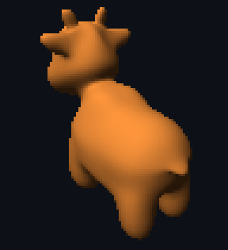

# term3d

[](https://github.com/khanuzai/term3d/actions/workflows/ci.yml)

A 3D model viewer that runs entirely in your terminal. Load an `.obj` file and
it spins, lit and smoothly shaded, in 24-bit color. Drag with the mouse to turn it,
and scroll to zoom.

<p align="center">
  
</p>

Everything is written from scratch in C++17, using only the standard library and
POSIX: no OpenGL, no ncurses, no third-party code. The
renderer (projection, rasterization, depth buffer, lighting) runs on the CPU and
writes ANSI escape codes straight to the terminal.

## Features

- **Half-block pixels**: each character cell shows two pixels with `▀`, foreground
  color on top and background color below, doubling the vertical resolution
- **Smooth shading** with crease-angle normals, so curves look round and sharp
  edges stay sharp
- **Mouse and keyboard**: drag to rotate, scroll to zoom, plus arrow keys
- **ASCII mode** (`--ascii`): brightness drawn with the characters `.:-=+*#%@`
- **Handles real-world models**: any polygon size, all OBJ face formats, negative
  indices, and inside-out or open meshes
- **Behaves like a good terminal program**: resizes with the window, suspends with
  Ctrl+Z, and always restores your terminal on exit

## Building

You need a C++17 compiler and CMake 3.16 or newer, on Linux or macOS.

```sh
git clone https://github.com/khanuzai/term3d.git
cd term3d
cmake -S . -B build
cmake --build build
```

## Usage

```sh
./build/term3d models/spot.obj
./build/term3d models/teapot.obj --color 4fa3ff
./build/term3d models/torus.obj --ascii --spin 0
```

| Control | Action |
|---|---|
| drag, arrow keys | rotate |
| scroll, `+` `-` | zoom |
| space | pause or resume the spin |
| `w` | wireframe on/off |
| `s` | smooth/flat shading |
| `r` | reset the view |
| `q`, Esc | quit |

<details>
<summary>All options (<code>term3d --help</code>)</summary>

```
--ascii          draw with ASCII characters instead of colored half-blocks
--light          for light-background terminals: reverse the ASCII ramp
--color RRGGBB   model color in hex (default ff963c)
--fps N          target frame rate, 1 to 120 (default 30)
--spin SPEED     radians per second, -10 to 10; 0 = still (default 0.8)
--wireframe      start in wireframe mode
--two-sided      always draw the backs of triangles (default: only for
                 meshes with holes, where you can see inside)
--one-sided      never draw the backs of triangles
--flip           reverse which side of each triangle is the front; closed
                 meshes are already fixed automatically
--flat           start with flat shading instead of smooth
--crease DEG     smooth shading keeps edges sharper than this angle sharp,
                 0 to 180 (default 60)
-h, --help       show this help and exit
```
</details>

term3d needs a terminal with 24-bit color, which most current terminals support,
and mouse reporting for drag and scroll.

## How it works

Each frame goes through the same steps a GPU would, done by hand:

1. **Load** the `.obj` file into a list of vertices and triangles
   ([`obj_loader.cpp`](src/obj_loader.cpp)). Polygons are split into triangles.
2. **Prepare** the mesh once ([`mesh.cpp`](src/mesh.cpp)): scale it to fit, check
   whether it's closed (every edge shared by exactly two triangles), and use its
   signed volume to turn inside-out meshes the right way round. Then compute
   smooth-shading normals for each triangle corner, averaging the faces at each
   point weighted by their angle there, but never across an edge sharper than
   the crease angle.
3. **Transform** each vertex with 4×4 matrices ([`math3d.h`](src/math3d.h)): model
   rotation, then camera, then perspective projection, then divide by *w*. Distant
   points end up closer to the center, which is what perspective is.
4. **Rasterize** each triangle ([`renderer.cpp`](src/renderer.cpp)) with edge
   functions. Barycentric weights interpolate both depth, for the **z-buffer**
   that sorts out what's in front, and brightness, for **Gouraud shading**.
   Triangles facing away are skipped (**back-face culling**).
5. **Light** with the Lambert cosine law plus a little ambient light.
6. **Output** the frame ([`framebuffer.cpp`](src/framebuffer.cpp)) as one string of
   ANSI escape codes. Colors are only sent when they change, and the frame is
   wrapped in "synchronized output" so the terminal never shows a half-drawn
   frame.

Around that: [`terminal.cpp`](src/terminal.cpp) handles raw mode, the alternate
screen and signals (resize, Ctrl+C, Ctrl+Z), [`input.cpp`](src/input.cpp) decodes
key and mouse escape sequences, and [`main.cpp`](src/main.cpp) runs a fixed-rate
frame loop.

## Project layout

```
src/                  the viewer
tests/                unit tests and a small test framework (tests/test.h)
models/               cube, torus, Utah teapot, Spot
tools/make_demo_gif.py   records the demo GIF above
.github/workflows/    CI: build and test on Linux and macOS, plus a sanitizer build
```

## Tests

```sh
ctest --test-dir build --output-on-failure
```

The tests cover the math, the OBJ loader, the mesh analysis and normals, the
input and command-line parsers, and the controls. CI runs them on every push,
with GCC on Linux, Clang on macOS, and with AddressSanitizer and
UndefinedBehaviorSanitizer.

To record the demo GIF again (Python 3, no packages needed):

```sh
python3 tools/make_demo_gif.py build/term3d models/spot.obj docs/demo.gif
```

## Credits

- **Spot** by Keenan Crane, released into the public domain, from
  [Keenan's 3D Model Repository](https://www.cs.cmu.edu/~kmcrane/Projects/ModelRepository/)
- The **Utah teapot**, created by Martin Newell at the University of Utah in 1975
